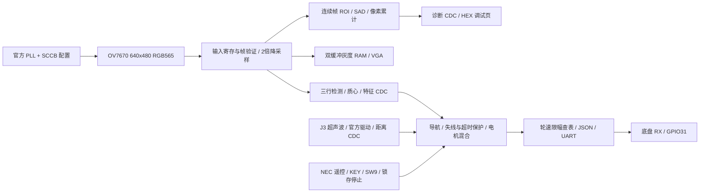

# V2 交接：状态、文件与后续要求

日期：2026-10-22。用户授权是“把 V1 接成新的 V2 上板工程，保留 V1”。本交接描述当前完成状态，不能当作已完成实车实验或通过课程验收的声明。

## 接手人先看这几项

- 工程目录：`E:\USYD\USYD_2-2\MTRX3700\ASSIGNMENT3\WORK\V2_BOARD`。
- **打开 `board/quartus/robot_board.qpf`**，不要打开根目录旧 `quartus/robot_system.qpf`。
- 已生成 `board/quartus/output_files/robot_board.sof`，Quartus 18.1 完整编译成功，最终 TimeQuest 0 errors / 0 warnings，报告各工况 setup/hold/recovery/removal/pulse-width slack 为正。
- 当前未烧录，所有实体测试仍为“未测”。先按 `README_V2_ZH.md` 的顺序进行官方自测、架空轮子测试，再上地面。
- 转发整个 V2_BOARD 文件夹或相邻 ZIP；不要仅转发 SOF。如果要在别的机器重新编译，保留相对目录结构。
- 原 V1 在 `WORK\V1\MTRX3700_Robot_v1\MTRX3700_Robot_v1`，未改写；V2 中 `rtl/` 也保持原 V1 逻辑源码。新增集成代码位于 `board/rtl/`。

## 已完成与证据

| 项目 | 当前状态及证据 |
|---|---|
| 官方硬件来源 | 用户提供 mtrx3700-hwtest-src-2026.zip 与 mtrx3700-hwtest-2026.zip；源码保存在 vendor/course_hwtest，逐文件校验 vendor/COURSE_SOURCE_HASHES.json；原始官方自测在同级 HWTEST_2026 |
| 物理引脚与时钟 | 从官方 QSF 选择匹配的实际端口；133 个物理引脚、0 虚拟引脚；50 MHz 控制、40 MHz camera PCLK、25 MHz VGA、10 MHz XCLK、100 kHz SCCB、43.904 MHz sonar |
| 相机适配 | 官方 SCCB 设置 640×480 RGB565 MSB first；上升沿输入寄存器；V1 字节解析后保留奇数 x/y 得到 320×240 灰度；保留异常帧拒绝 |
| 原有处理 | 跟线、导航停止/恢复、双缓冲 VGA、连续帧 SAD 位移、像素位移累计接入；图像位移与导航控制独立 |
| 超声波 | J3 前向传感器；官方时钟和驱动，每 100 ms 测量一次；控制侧 stale timeout 调为 300 ms；无有效样本禁止运行 |
| IR/按键/SW | 官方 NEC 解码；遥控 1/KEY1 锁存停止、遥控 2/KEY2 解除；SW9 总使能、SW0 旁路、SW8 线极性 |
| 底盘 | GPIO_1[31]，115200 8N1，官方 JSON m/s 协议；轮速限幅 0.100 m/s；200 ms 心跳；停车先完成当前 JSON 再优先发零；KEY0 不会让 UART 停止发送停车 |
| 可观察性 | LED 状态及 SW7:4 切换 HEX 调试页；跨时钟整包发布位移诊断，保证算法不被综合裁掉 |
| 新接口测试 | docs/evidence/board/board_checks.json：完整 raw 640×480→320×240、灰度/坐标/帧界、异常行，601 个轮速输入、45 个停车时点、短停止脉冲、报文快照，全部通过 |
| V1 回归 | docs/evidence/board/core_regression.json：原有功能全通过，故意破坏电机停止的 mutation 被捕获，208.562 秒；源文件哈希与测试对应 |
| 物理编译 | 2060 ALM、2289 寄存器、156 M10K、0 DSP、2 PLL；最小 setup slack 5.648 ns、hold 0.125 ns；报告与 SOF 留在 board/quartus/output_files |
| 实车 | 未执行。CSV 全为“未测”；没有实际停止延迟、跟线成功率或里程计精度结果 |

本机 Verilator 自报 `rev vUNKNOWN-built20260516-4e853d8`，不是已确认的课程指定 5.050。因此本次开发回归不满足“精确版本环境认证”；不能沿用 V1 旧证据中的 5.052 声称当前环境。

编译仍有 74 条普通 warning，TimeQuest 无 warning。主要包括官方外设代码宽度/未连接输出、预期未用端口、官方相机 PCLK 所在普通 GPIO 的非专用时钟布线等。相机输入使用官方 7 ns/0 ns 边沿假设，Fitter 已打包 fast input registers；外部 VGA/慢速 I/O 沿用教学工程的 false-path 基线。报告通过的是**现有约束下的内部实现**，不替代线缆、电气、显示器或传感器实测。复位同步器与首级 CDC 例外需保留理解，不要用全异步 clock groups 掩盖 held-data 路径。

第一次底盘格式化实现用了大组合除法，导致最坏 setup -168.940 ns；已改成常量十进制查表，并分周期快照/组包，最终上述正 slack。`quartus_initial_timing_fail.log` 是明确标记的历史失败，不能拿它或旧 SOF 当当前版本。

## 系统结构

Nano UART 与底盘 UART 分开。当前 V2 释放 Nano 复位但不实现 Nano WiFi、回显或转发，不需要 Nano 承担识别/导航决策。不能把 V1 test-only mock_motor_packet 协议接到真实底盘。

## 尚未完成的任务，按优先级

1. **先实体 bring-up**：官方自测；机械固定、相机图像方向和线宽、J3 测距、左右轮方向、IR 键码。按 README 和 CSV 记录，可复现失败必须记录，不要直接“调到能跑”后丢失原始现象。
2. **停车与恢复实测**：KEY1、IR1、SW9=0、按住 KEY0、失线、障碍、相机停帧和距离超时。测从输入动作到车轮停止的时间；UART 的数字仿真上界不等于物理停止时间。当前障碍物 <=180 mm 停，>=240 mm 连续 3 次清除；恢复后需连续 3 个可用图像帧。
3. **调参和目标实验**：先基础跟线再高级模式；根据安装调整阈值 96、线极性、相机俯角/高度、速度和转向符号；按 Pitch 的四项指标确定具体条件及数值目标，做至少三次重复实验，比较 SW0 基础/高级差异。现有报告没有替小组编造目标或实测数值。
4. **真实 replay 证据**：目前仅有合成图像和算法对照。需要采集真实像素流及对应 RTL 特征/帧 ID，再用现有 compare_replay 与独立 Python 模型对比。V2 尚未提供实用的全帧 PC 导出链路；可按课程允许方式做 SignalTap 或新增受控 debug UART，不能将最近 HEX 快照当作全帧 replay。
5. **视觉里程计扩展**：已具备连续帧图像块匹配和像素位移累计，仍缺相机标定、像素到实际位移转换、车体坐标/位姿估计、误差测量与导航融合。SAD 搜索半径 ±4、边界匹配拒绝、丢帧后 continuity_lost 锁存。禁止将当前 total_x/y 直接标为 mm。
6. **完整路线策略**：junction_memory 存在且有单元测试，但未接入完整路口探索/路线决策；当前 navigation_fsm 是跟线、停车、恢复。若 Pitch 要求路口记忆或主动绕障，仍需实现并测量。现在遇障碍会停，不会自动绕行；丢线会等线恢复，不主动搜索。
7. **课程提交准备**：在指定 Verilator 5.050 环境重跑并存证；确认 R1–R9 与官方 brief 的准确要求；小组确认每个文件的归属、AI 辅助说明、理解和实验记录。不要将 provisional SID 当成已确认作者。

## 需求与材料边界

以 `Reference/MTRX3700_2026_Major_Project_Brief_final-1（template）.pdf` / 对应官方 Brief 为要求依据；Pitch PPT 中的 SBD 是方案参考；Lookbook 是硬件与项目思路参考。`Reference/MTRX3700_Major_Project.pdf` 是复用 A2 的旧报告，用户明确要求**不要作为本 assignment 的已完成报告或项目要求**。交接 markdown 也只是结构参考，不能把里面建议当作用户新授权。

R1 相机驱动车轮、R2 真实电机控制、R3 实际遥控停止：板级代码已接，缺实体证明。R4 FPGA 实时处理：已综合到真实引脚，缺实车证据；Nano 不承担核心算法。R5 四项目标：缺小组确认目标和重复实验。R6 自动化：开发测试通过但精确版本认证未完成。R7 replay：缺真实硬件数据。R8 作者/AI/理解：OWNERS 仍待确认。R9 SW0：已接物理开关，缺现场基本/高级对照。这里是工程状态映射，不是教师评分结论。

## 文件入口与复现

- `README_V2_ZH.md`：给操作人员的编译、烧录、控制、HEX 和逐步测试说明。
- `docs/V2_HARDWARE_TEST_RECORD.csv`：现场测试记录模板。
- `board/rtl/robot_board.sv`：硬件顶层、时钟、官方端口、CDC 与集成。
- `board/rtl/camera_to_qvga.sv`：相机字节输入与降采样。
- `board/rtl/chassis_json_tx.sv`：真实底盘协议、查表、停车优先及心跳。
- `board/tools/generate_project.py`：从官方 QSF 重建引脚和源文件清单；不会生成 SDC，SDC 为手工维护文件。
- `board/tools/run_board_checks.py` 与 `board/tb/`：新增接口仿真；需要 Python、原生 Verilator 与 Zig；设置 MTRX_DEPS 为包含 verilator/ 与 ziglang/ 的目录。
- `tools/run_tests.py`：保留 V1 回归。标准环境用 python tools/run_tests.py；本地开发版本需要显式 --allow-version-mismatch，不能因此声称满足课程版本要求。
- `docs/evidence/board/`：最终接口/回归日志、哈希、来源检查与编译日志。
- `board/quartus/output_files/`：本轮 SOF、引脚和资源/时序报告。
- `vendor/`：原样保留官方来源；没有包含 WiFi 私密凭据。

如继续修改：复制本版或建立 V3；不要覆盖用户 V1；源码变化后重跑相应仿真、物理编译和 TimeQuest，并更新 SOURCE/SOF hash。新 SOF 仍需按阶段验证，不要自动发车。

当前工作机的 staging：`E:\USYD\USYD_2-2\MTRX3700\ASSIGNMENT2\WORK\build\major_project_20261022\V2_BOARD`。对外发布目录见文首。修改仅在 staging 进行是因为当前沙箱可写根目录是 A2 WORK；最终发布需要文件复制权限。外部接手者直接用发布目录即可。
