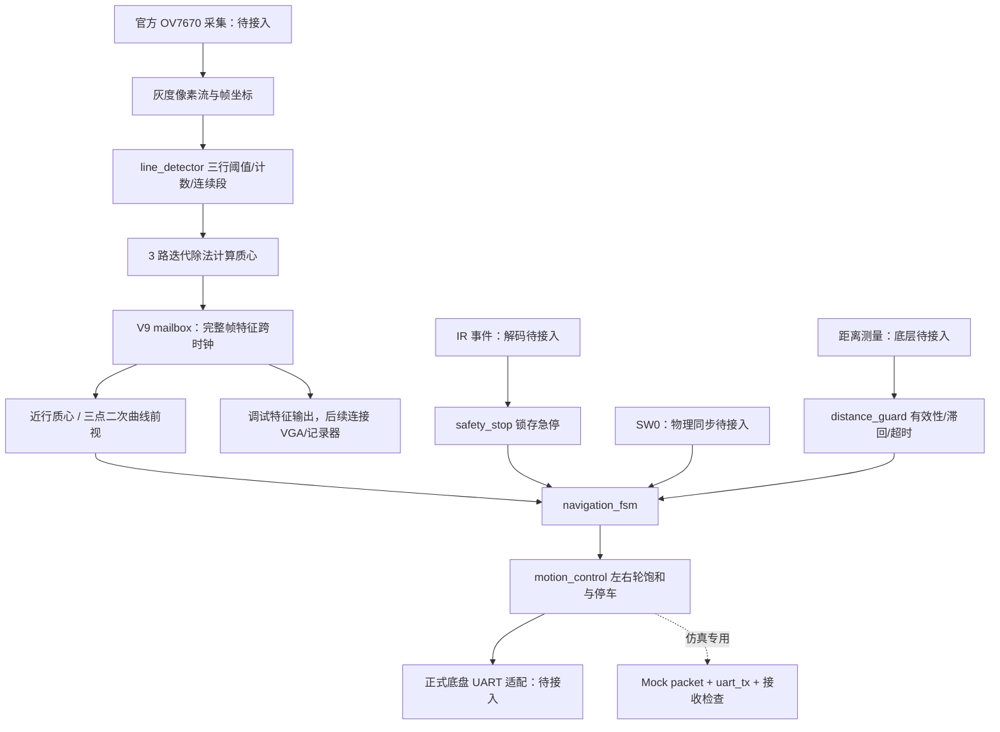

# MTRX3700 Major Project：第 1 轮系统结构与进度报告

日期：2026 年 10 月 19 日。交付目录：`ASSIGNMENT3/WORK/MTRX3700_Robot`。

## 本轮结论

已经建立独立的机器人 RTL 工程，完成“实时像素流 → 三行线特征 → 基础/前视跟踪 →
安全仲裁 → 左右轮命令”的可综合实现，并在仿真中通过测试专用串口协议验证了完整链路。
本地完整功能回归通过，故意破坏停车输出的副本被检出并打印 `CAUGHT`。
默认 320×240 核心通过 Quartus 综合、布局布线和时序分析。

**当前不能直接上车运行。** 真实 OV7670 配置/采集、IR 解码、超声波电气接口和
Nano/UGV02 命令适配尚未接入。没有实车测量、真实硬件回放或可下载的机器人 `.sof`。
本轮完成度按功能和证据列出，不用“百分之多少”代替尚未验证的硬件工作。

## 系统结构

摄像头域只做逐像素处理、行统计和除法。50 MHz 控制域接收整包特征，进行导航、安全
仲裁和运动控制。两域分别同步释放复位；特征邮箱拥塞会锁存故障并停车。
处理器/Nano 不参与图像计算或运动决策。

仲裁顺序：急停 → 必需距离输入失效 → 障碍停车 → 图像失效/超时/恢复不足 →
基础或前视跟踪。复位默认停车；急停与释放同时到达时急停优先。解除急停后必须重新
获得连续 3 个有效帧。失线后当前采用**停车等待重新看见线**，没有开启盲目搜索或绕行。

## 实现进度

| 部分 | 本轮实际完成 | 未完成边界 |
|---|---|---|
| 实时线检测 | 有效像素流、坐标检查、三行质心/计数/连续段、帧发布 | 真实光照、赛道宽度、阈值与相机安装标定 |
| 曲线前视 | 三点二次插值、方向/二阶差分、SW0 基础对照 | 尚未证明实车转弯误差改善；输出是像素量，不是物理曲率 |
| 安全与导航 | 锁存急停、最高优先级、图像超时、连续帧恢复、CDC 故障停车 | 物理遥控输入、底盘停车延迟 |
| 障碍处理 | 距离有效性、180 mm 停车/240 mm 连续清除门限、超时保护 | 数值为初始工程参数；移动绕障与主动重新找线未实现 |
| 运动控制 | 方向符号、速度混合、±255 饱和、禁止时归零 | 实车单位、轮向、限速、摄像头镜像需要核实 |
| UART | 通用 8N1 发射器、逐位验证、可中止字节 | 实际 Nano/UGV02 协议未知；mock 不能接车 |
| 路口记忆 | 独立有界表、已走分支记录、每次路口一次决策、淘汰策略 | 未接导航；需要真实路口识别和稳定 ID，不能仅用出现次数冒充重访 |
| VGA | 提供一致的特征/状态调试输出 | 实时画面缓冲、时序、叠加显示未实现 |
| 视觉里程计 | 保留未来接口和低优先级路线 | 算法、RTL、测试、测量均未实现，没有假数据模块 |

完整信号宽度、公式、时钟和接口说明见 `ARCHITECTURE.md`、`INTERFACES.md`。

## 本轮执行的验证

完整开发环境回归记录：`docs/evidence/test_results.json`、`positive.log`、`negative.log`。
初次完整通过用时 **71.69 秒**；交付目录从干净构建开始复跑用时 **87.67 秒**，
全部通过并再次检出故障。最终结果记录于 evidence JSON。

| 验证 | 结果 | 覆盖 |
|---|---|---|
| 全尺寸 RTL lint | PASS | 默认 320×240 核心 elaboration，无压制 fatal 警告 |
| 质心金模型比对 | PASS | 36 组独立 Python 模型图像；正/反极性、阈值相等、断续像素、宽线/多线/窄线 |
| 帧完整性与 CDC | PASS | 错位像素拒绝、每帧整包传递、帧 ID、双时钟及拥塞锁存 |
| 二次曲线计算 | PASS | 32³=32768 组位置组合穷举 |
| 迭代除法器 | PASS | 220 组输入，含除零，核对周期数 |
| 安全与轮速 | PASS | 600 组 stop/release、饱和边界、禁止时归零 |
| UART 位流 | PASS | 256 个字节、8N1 位时间、40 个发送位置中止 |
| 距离与路口单元 | PASS | 门限/滞回/超时/无效值；分支记忆、重访、淘汰 |
| 系统链路 | PASS | 图像改变轮速和解码后的 mock UART；SW0 改变输出；失线/断帧/障碍恢复 |
| 全导航状态急停 | PASS | 从六种非急停状态进入急停并保持 |
| 故意破坏模块 | CAUGHT | 临时副本停车左轮变成 1，指定断言失败；生产 RTL 未改坏 |
| 回放比对器自检 | PASS | 正例、错误特征、重复帧、缺失帧 |

本机 Verilator 二进制版本输出为 `rev vUNKNOWN-built20260516-4e853d8`，安装包元数据
为 5.48.0。查询本机可访问包源未找到 5.050。**因此尚不能宣称 R6 指定版本验收完成。**
标准 `run_all_tests.sh` 默认检查 5.050；本地兼容运行必须显式允许版本不匹配。

本轮金模型与回放自检使用**合成数据**。它们不能替代 R7 所需真实硬件录制。
数据格式和采集方法已写入 `data/README.md` 与 `VALIDATION_PLAN.md`。

## Quartus 资源与时序结果

Quartus Prime Lite 18.1；器件 5CSEMA5F31C6；默认 W=320、H=240。
这是一份**虚拟数据引脚核心估算工程**，不是机器人板级实现。

| 项目 | 实际工具结果 |
|---|---|
| Analysis & Synthesis | Successful，0 errors |
| Fitter | Successful，0 errors |
| Timing Analyzer | Successful，0 errors / 0 warnings |
| ALM | 488 / 32,070 |
| 寄存器 | 686 |
| RAM / DSP / PLL | 0 / 0 / 0 |
| 虚拟数据引脚 | 177 |
| 时钟假设 | control 50 MHz；camera 24 MHz |
| control 最低报告 Fmax | 109.59 MHz（两个 slow corner 的较低值） |
| camera 最低报告 Fmax | 131.22 MHz（两个 slow corner 的较低值） |
| control 最差 setup slack | +10.875 ns |
| camera 最差 setup slack | +34.046 ns |

限制必须连同这些数字一起看：外部 I/O 延迟尚未约束；两个时钟没有正式引脚位置，Fitter
有对应警告；未包含真实摄像头/VGA/底盘适配，独立 UART 和路口模块未在 core 中实例化，
所以不计入上述核心开销。工具明确报告设计未完全约束，**不能据此宣布整机时序签核**。
完整报告见 `docs/evidence/robot_core.fit.summary`、`robot_core.sta.summary` 和 `.rpt`。

## 文件、来源与分工

实际新增/交付文件逐项列在 `FILE_MANIFEST.md`。源码和工程配置的来源/拟归属在 `OWNERS.md`。
只从明确标记的 A2 V9x 复用 reset_sync 和 cdc_mailbox，并适配了 Quartus 同步器属性。
未复制 ShineSing 顶层、FFT、音频、静态图像 ROM 或游戏逻辑。

保留 Pitch 的四人职责。共享集成和测试文件仍需组内确认负责人；540794940 的 VO
贡献尚未有实际模块及测试，不能算满足 R8。所有新代码均需对应成员阅读、理解和审核。

本轮实际修正的兼容性/约束问题与验证方式记录于 `AI_AND_DECISIONS.md`，供后续报告
挑选真实调试案例；不使用 A2 的旧测试表冒充机器人结果。

## 下一轮可直接接手的工作

1. 取得 Ed Major Project Resources：官方硬件自检、适配板 QSF、OV7670 配置/模型、
   Nano 中继固件及底盘 UART 文档、IR 解码和超声波接口。先接完整相机到轮子基础闭环。
2. 用官方 self-test 检查设备，再接 IR 锁存急停并验证实际停车。轮子抬离地面核对
   左右轮正负、速度尺度、图像镜像和 SW0；不能直接连接仿真 mock 协议。
3. 采集真实像素与 RTL 特征，执行金模型比对。记录帧率、相机配置和源代码/bitstream 哈希。
4. 在稳定基础闭环上发展移动绕障、有效路口识别及记忆消费，并为新增状态增加测试。
5. VO 保留在后续阶段；先采集连续帧并验证离线位移估计，再决定 FPGA 方案。
6. 在实际轨道上确定 3–5 个测量目标的条件、threshold、goal、三次取值规则，完成
   真正的 SW0 对照。Pitch 的四项目标仍保留，但没有编造阈值或 measured 数据。
7. 在 Verilator 5.050 干净副本运行自动测试，并完善全员所有权、datasheet、最终 bitstream
   及正式 Q1–Q7 报告。此次进度报告不是最终作业报告。

正式时间点按已核查 brief：11 月 4 日 demo video；11 月 5 日 demo/Q&A；
11 月 8 日 23:59 代码与报告。Pitch 中 10 月 18 日的“首次运动”是原计划，不是已完成证据。
