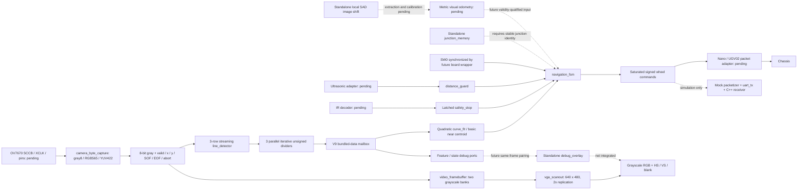

# System architecture — second implementation, 19 October 2026

This is a hardware-independent logical RTL system, not a finished robot bitstream. The
PPT's camera → line detection → navigation → motion → UART design is retained.
The present closed-loop simulation uses real pixel-stream semantics and a
**test-only** motor packet receiver. No wheel motion has been measured.

## Implemented responsibilities

| Module | Responsibility | Integration |
|---|---|---|
| `camera_byte_capture` | Decode byte pairs, latch format at VSYNC, validate HREF length, withhold last pixel until line is validated | Shared camera input in `robot_system` |
| `line_detector` | Validate full raster ordering, threshold three rows, count pixels/runs, publish frame-consistent features | Core camera domain |
| `unsigned_divider` | Restoring unsigned division, exactly WIDTH cycles, explicit zero denominator | Three detector instances |
| `cdc_mailbox` | Hold whole feature packet until request/ack crossing completes | Adapted/reused V9 building block |
| `curve_fit` | Interpolate quadratic through equally spaced rows; report heading/second difference | Both basic and advanced paths |
| `safety_stop` | Reset to stopped, stop wins release, separate release event required | Highest motion priority |
| `distance_guard` | Inclusive close threshold, release hysteresis, sample validity and timeout | Core control domain |
| `navigation_fsm` | Priority, freshness, frame recovery, SW0 mode | Core control domain |
| `motion_control` | Left/right mixing and signed saturation; zero on inhibit | Core output |
| `uart_tx` | Handshaken 8N1 bytes, optional abort | Unit tested; connected to simulation mock only |
| `junction_memory` | Bounded keyed history with untried branch policy and eviction | Standalone; not connected to navigation |
| `reset_sync` | Asynchronous reset assertion, two-stage synchronous release | One per domain |
| `video_framebuffer` | Two owned frame banks, validate raster, swap only at requested blanking boundary | Separate display branch; never stalls control |
| `vga_scanout` | 2x coordinates, synchronous RAM latency, active/sync timing | Default 640×480, 800×525 total |
| `camera_debug_display` | Resets, frame RAM, scanout and black masking | Live grayscale display |
| `debug_overlay` | Valid-centroid crosses, sample rows, stop stripe | Unit tested; same-frame integration pending |
| `robot_camera_system` | Capture + core without frame RAM | Optional lightweight integration top |
| `robot_system` | One capture feeds core and VGA branch | Current complete logical top |
| `image_translation_sad` | Local 16×16-to-24×24 matching, best/runner-up SAD and validity | Standalone prototype, no motion-control connection |

## Clock domains and resets

- `cam_clk`: externally supplied camera pixel-stream clock; assume 24 MHz only
  for resource/timing experiments. Pixel capture, row statistics and division
  run here. `robot_system` decodes the configured byte format; direct `robot_core`
  users must supply already normalized grayscale pixels.
- `clk`: assume the DE1-SoC 50 MHz board clock. Safety, navigation, normalized
  distance, motion and UART run here. There is no audio clock dependency.
- `video_clk`: independently supplied pixel clock, assumed 25 MHz for resource
  estimates. Scanout, framebuffer read port and display bank selection run here.
  Default timing at 25 MHz gives about 59.52 Hz; physical monitor testing and PLL
  configuration remain pending.
- `arst`: asserted to all three domains together. Each domain releases reset through
  its own synchronizer. Motor inhibit also includes `arst` combinationally.
- Feature mailbox carries data atomically, never individual live pixel bits.
  Source payload stays held until ack. A busy mailbox at publication latches
  `cam_overrun`; its synchronized copy inhibits motion until global reset.
- Pin-level IR events, distance samples and SW0 **must be synchronized by the
  future board adapter**. `robot_core` accepts synchronous logical events.
- Digital simulation cannot prove metastability MTBF. Preserve synchronizers
  and review CDC paths/constraints in the final board fit.

## Stream protocol and data widths

Default image is 320×240. Supported intended parameter range: W=8..1024,
H=8..1024 divisible by four for the detector; other values require validation.
The display branch is budgeted only at default 320×240. Detector/control need no
full frame RAM; the display branch allocates two frames. One gray sample is accepted on each asserted `pixel_valid`; gaps
are allowed. SOF accompanies (0,0); EOF accompanies (W-1,H-1). No backpressure.
Threshold and polarity latch at SOF. An incomplete frame is discarded when a
new SOF arrives. A malformed EOF frame publishes `frame_good=0`.
An explicit camera-domain `frame_abort` publishes invalid features, cancels any
pending good divider result, and invalidates the current unpublished display
frame. The independent camera watchdog handles a source that freezes without an
abort. Frame IDs count completion/abort events; a canceled pending result can
leave a gap. A logger must preserve the reported ID rather than assume every
image had a published result.

Rows far/middle/near are H/4, H/2, 3H/4. At default dimensions:

| Signal | Width / meaning |
|---|---|
| gray, threshold | 8-bit unsigned luminance / threshold |
| x, y | 9-bit x / 8-bit y |
| row sums | `ceil(log2(W*W))` = 17 bits each |
| row counts | `ceil(log2(W+1))` = 9 bits each |
| centroids | 3 × 9 bits, low slice = far row |
| row_valid / junction | 3 bits each, far at bit 0 |
| frame ID | 16 bits, wraps modulo 65536 |
| mailbox | 77 bits = 16 + 27 + 27 + 7 |
| steering / wheel commands | Signed 16-bit abstract units |
| speed | Unsigned 8-bit abstract units |
| distance_mm | Unsigned 16-bit millimetres; accompanying valid/sample |

Centroid is floor(sum_x / count). A row is valid only with 2..W/2 selected
pixels and exactly one contiguous run. Multi-run or overly broad regions set
`junction`, but this is only an **ambiguity candidate**, not junction recognition.
Basic mode requires the near row; advanced mode requires all three.

Three parallel dividers accept the sums at EOF, take 17 camera cycles at the
default size, then publication and mailbox CDC add several clock cycles.
The dominant real latency remains frame acquisition and the undocumented motor
packet scheduling. No camera-to-UART millisecond measurement is claimed yet.

## Curve model and bypass

Near row is t=0, middle t=1, far t=2. The three samples define a quadratic.
At lookahead t=1.5, target x = (-near + 6×middle + 3×far)/8, truncated toward
zero then clipped into image bounds. Basic error = near-W/2; advanced error =
target-W/2. Heading = far-near; curvature indicator = near-2×middle+far.
These are pixel-domain quantities, not a calibrated heading angle or curvature
in m⁻¹. All gain, speed, threshold and range defaults are engineering starting
values; they are not group-approved measurable performance thresholds.

SW0 logical input `bypass=1` selects basic tracking at speed 96. `bypass=0`
selects quadratic target, with a reduction up to 40 units from speed 96 according
to image heading. Positive steering makes the left motor command larger.
Motor command = clamp(speed ± 2×error, -255, 255). Real motor polarity, scale,
camera mirroring and permissible reverse motion must be validated on the rig.

## Arbitration and state behaviour

| Code | State | Entry / output | Exit |
|---|---|---|---|
| 6 | E_STOP | Reset, stop pulse or latched stop; zero | Separate release plus fresh frame sequence |
| 4 | SENSOR_FAULT | Required sensor unseen/invalid/stale; zero | Valid clear sensor samples and valid image sequence |
| 5 | OBSTACLE_STOP | Required sensor reports blocked; zero | Three consecutive ≥240 mm samples, then valid frames |
| 0 | INIT | No accepted frame since reset/release; zero | Fresh accepted frames |
| 3 | LINE_LOST | Invalid row/frame, expired image, or recovery incomplete; zero | Three consecutive usable fresh frames |
| 1 | FOLLOW_BASIC | Fresh near row and bypass=1 | Higher priority event or mode change |
| 2 | FOLLOW_ADVANCED | Fresh all three rows and bypass=0 | Higher priority event or mode change |

The state is a combinational view of registered conditions. Stop pulse is included
directly in arbitration, so no ordinary FSM transition can delay the zero command.
An independent CDC fault also gates motion; inspect `cdc_fault` alongside state.
No moving search, reverse manoeuvre, planned detour or junction turn is enabled.
The current recovery means stationary reacquisition, not autonomous obstacle bypass.

## Display memory and future integration

Detector stores only row sums/counts/runs, divider working state and one feature
packet. Display stores 2×320×240×8 = 1,228,800 bits in 152 M10K blocks after fit.
The camera writes only its free bank; it holds the published bank index while a
toggle request crosses two registers into the video domain. The video domain
adopts the completed bank only at the start of vertical blanking, then returns
an acknowledgement. The camera waits for that acknowledgement before reusing
the former display bank. Complete arriving frames are dropped while pending;
there is no pixel backpressure and control does not wait for the display.

RAM contents are not reset. Valid flags mask unwritten memory and RGB is black
during blanking/reset. Both domains must reset together. A camera failure leaves
the last complete display image visible, while the separate controller enters
stop; a live gray image alone is not a motion-health indicator. The standalone
overlay is not yet connected because detector features arrive after EOF and
must be paired with the displayed bank, including dropped/aborted frames.

The default scan has H=640/16/96/48 and V=480/10/2/33 active/front/sync/back
intervals, verified against the V9 generated VGA controller. Coordinates, sync
and blanking are delayed one read cycle to align with the synchronous frame RAM.
The control and display branches share normalized capture but no ready signal.

Junction memory has 8 entries by default (key8 + tried3 + occupied). It needs a
trusted recognition/localisation producer before connecting to motion; a simple
incrementing junction counter does not establish revisit identity.

The standalone image_translation_sad kernel is implemented and tested, with
integer image-pixel dx/dy, quality gates and a frame-ID pair. It requires a future
pairing/extraction stage and does not provide dtheta or metric pose. See
IMAGE_TRANSLATION.md for its handshake, failure modes and compute latency.

Future metric VO contract: frame ID, signed dx/dy/dtheta in documented fixed-point
units, valid, confidence and age. Every consumer must function with valid=0.
There is no VO stub returning fabricated measurements, nor command integration
mislabelled as visual odometry.
