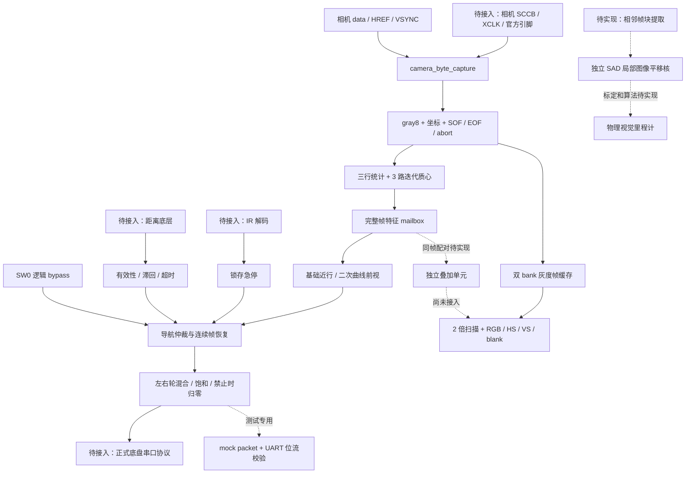

# MTRX3700 Major Project：第 2 轮系统结构与进度报告

日期：2026 年 10 月 19 日。交付目录：`ASSIGNMENT3/WORK/MTRX3700_Robot`。

## 当前成果

在第一轮控制核心基础上，已完成**可配置相机字节采集 → 实时线检测 → 控制/安全仲裁 →
轮速命令**与**同源图像 → 双帧缓存 → 实时灰度 VGA**的统一逻辑顶层。
默认 320×240 输入和完整 640×480 显示已做功能仿真；完整系统已通过 Quartus 布局布线。
另完成局部 SAD 图像平移估计核及独立测试，作为视觉里程计方向的前置算法原型。

当前仍不是可直接上车下载的工程。真实摄像头配置、板级引脚、IR/距离底层适配和
Nano/UGV02 正式命令协议尚未接入，没有物理行驶、硬件回放数据或机器人 `.sof`。
本地资料中复用 A2 的 major-project 报告没有被当成本次作业要求或测试结果。

## 系统结构

三个时钟域：相机域负责采集、线统计、除法和帧缓存写入；控制域负责特征接收、导航和
轮速；视频域负责帧缓存读取与 VGA 扫描。全部复位一起断言，各域同步释放。
SAD 原型单独使用一个处理时钟，尚未接入上述三个域。

显示采用完整帧所有权握手，只在垂直消隐开始时换 bank。相机可能丢弃显示帧，但不会
等待显示端；专门暂停显示时钟的测试已确认控制和急停继续工作。图像失效后，显示可能
保留上一完整帧，因此不能仅凭屏幕上有画面判断控制正常。

## 本轮新增代码与进度

| 部分 | 本轮已实现与验证 | 尚未完成 |
|---|---|---|
| 相机字节采集 | gray8、RGB565、YUV422；字节顺序与格式在 VSYNC 锁存；HREF 长度检查 | 官方 OV7670 设置、采样边沿、镜像、同步极性与真实输入验证 |
| 异常帧处理 | 短行、长行、奇数字节、提前 VSYNC；末像素等待 HREF 结束；abort 取消待发布质心 | 物理噪声与实际故障录制 |
| 统一逻辑顶层 | `robot_system` 共享一份采集，同时驱动控制和显示 | 独立板级 wrapper、物理 GPIO、PLL 与外部时序 |
| 实时 VGA | 双帧缓存、整帧丢弃/切换、灰度 2 倍显示、同步和消隐对齐 | 实际显示器/DAC 接线与像素时钟验证 |
| 调试叠加 | 质心十字、采样行、停车条的独立单元及测试 | 将显示 bank 与同一帧的特征配对；当前实时画面仍为灰度 |
| 图像平移原型 | 16×16 参考块与 24×24 搜索窗；81 位移穷举 SAD；最佳/次佳误差、纹理、帧 ID 门控 | 相邻帧采样配对、真实场景评估、标定、旋转/透视建模和物理 VO |
| 原有控制 | 保留曲线前视、SW0 对照、失线/超时停车、距离停车、连续帧恢复和急停优先级 | 移动绕障、主动找线、稳定路口识别、正式 UART 适配 |
| 所有权与溯源 | 新源文件全部列入 OWNERS；Pitch VO 成员保留为平移核拟审阅人 | 学生本人审阅理解、组内确认及最终提交声明 |

`robot_camera_system` 是不包含显示 RAM 的轻量顶层；`robot_core` 保留归一化像素接口。
没有把测试用 mock 协议写成底盘协议，也没有把图像位移叫作已完成的物理里程计。

## 执行的验证

最新日志和哈希在 `docs/evidence/round2/`。完整自动回归包括正常代码、独立参考比对和
临时错误副本；生产 RTL 的停车零值没有被改坏。具体运行耗时以该目录
`test_results.json` 为准。

交付目录内另建了无 build 缓存的源码副本，完整运行 **200.594 秒**，正常测试和错误注入
均通过。对应记录为 `clean_copy_test_results.json` 与 `clean_copy_source_snapshot.json`。
这次冷启动测量之后只修补了测试入口的旧结果清理；RTL/测试台未变，交付目录最终完整
回归另记在 `test_results.json`。版本拒绝及清理检查在 `version_gate_probe.log`。

| 检查 | 结果 | 主要证据范围 |
|---|---|---|
| 原有模块和系统回归 | PASS | 36 组合成金模型帧、32768 曲线组合、UART 全字节、600 安全序列、距离/路口/导航异常 |
| 相机采集 | PASS | 三种格式、顺序、RGB 灰度转换、坐标和帧边界、异常长度、格式锁存 |
| 异常帧与除法并发 | PASS | 中止正在计算的质心，不允许随后发布旧的有效结果 |
| 双时钟缓存 | PASS | 双 bank 逐像素读回、并发写读、等待换帧时丢帧、畸形帧拒绝、复位 |
| 小尺寸 VGA | PASS | 每个扫描位置、完整换帧、同步/消隐、2 倍像素和 RAM 延迟 |
| 三时钟隔离 | PASS | 独立 10/14/22 tick 时钟；暂停显示时钟不阻塞控制和急停 |
| 默认 QVGA 控制 | PASS | 4 帧 320×240 原始输入；9 位坐标/计数；计数 159、坐标超过 255；基础/前视轮速 |
| 默认 VGA 全帧 | PASS | 420000 扫描位置，307200 有效像素；50400 个 HS 低位置、1600 个 VS 低位置 |
| SAD 图像平移 | PASS | 全部 81 个偏移；独立批量最优/次优误差；平坦/周期/无关图拒绝、装载错误、忙态隔离、复位、最大值 65280 |
| 故意破坏停车值 | CAUGHT | 停车左轮改成 1 的临时副本触发指定断言；编译失败不算检出 |
| 测试入口失败路径 | PASS | 错误 Verilator 版本返回非零，旧的 PASS JSON 被清除 |
| Quartus | PASS | 完整逻辑系统与独立 SAD 核的综合、布局布线和时序分析 |

本机二进制仍报告 `rev vUNKNOWN-built20260516-4e853d8`，不是已核实的 Verilator 5.050。
标准脚本默认要求 5.050，本机回归显式使用开发兼容选项。**R6 指定版本验收仍未完成。**
全部图像测试均为合成输入；默认尺寸测试也不能替代 R7 真实硬件录制。

## FPGA 资源与时序

Quartus Prime Lite 18.1，Cyclone V `5CSEMA5F31C6`。以下是虚拟数据引脚估算，不是
真实机器人板级时序签核。没有运行下载或编程操作。

| 项目 | 集成 `robot_system` | 独立 `image_translation_sad` |
|---|---:|---:|
| ALM | 689 / 32070 | 263 / 32070 |
| 寄存器 | 920 | 167 |
| RAM 位数 | 1228800 | 6656 |
| M10K | 152 / 397 | 2 / 397 |
| DSP / PLL | 0 / 0 | 0 / 0 |
| 虚拟数据引脚 | 191 | 158 |
| 未定位时钟引脚 | 3 | 1 |

两列为分别编译的顶层，不能直接相加当作未来集成后的工具结果。SAD 尚未实例化进
robot_system，因此当前机器人资源不含该核及其未来帧提取/存储成本。

集成系统假设 control=50 MHz、camera=24 MHz、video=25 MHz。两个 slow corner 中较低的
Fmax 分别为 **107.69 / 73.81 / 128.16 MHz**；各时钟最差 setup slack 分别为
**+10.714 / +28.118 / +32.197 ns**。独立 SAD 核假设 50 MHz，较低 Fmax **88.83 MHz**，
最差 setup slack **+8.743 ns**。

外部数据到达/负载未约束，时钟未指定正式管脚；Fitter 存在相应警告。CDC 请求/确认有
同步链，保持的特征/帧 bank 数据路径有显式约束，但数字仿真不能证明亚稳态 MTBF。
接入官方驱动、PLL、管脚和 I/O 约束之后必须重新做完整分析。

SAD 默认计算阶段为 41473 时钟，假设 50 MHz 对应 0.82946 ms。这个数字不含相机帧率、
图像块装载、CDC、外部命令或车体响应，不能当作端到端控制/里程计测量。

## 交付文件与复现

当前阅读入口是根目录 `README.md`；结构和接口分别在 `ARCHITECTURE.md`、`INTERFACES.md`。
局部平移核详见 `IMAGE_TRANSLATION.md`；正式要求缺口见 `REQUIREMENTS_MATRIX.md`。
`FILE_MANIFEST.md` 列出交付文件；本轮源文件哈希在
`evidence/round2/source_snapshot.json`，防止代码与证据混淆。

第一轮的源码、报告和证据保存在 `releases/round1_source_and_evidence.zip`，
`ROUND1_PROGRESS_ZH.md` 和 evidence 根目录仍是第一轮历史记录。它们不代表最新模块数量
或最新资源用量。新证据统一放在 `evidence/round2/`。

标准环境：`bash run_all_tests.sh`。Windows 本机开发兼容命令和 Quartus 完整逻辑顶层
编译命令见 README。编译产物和缓存不作为源码交付；工具在本机 A2 目录下的路径仅是
开发环境依赖，不代表 Major Project 源码依赖 A2 的项目结构。

## 后续优先顺序

1. 获取官方机器人自检、QSF/接线、OV7670 配置、Nano/UGV02 串口协议、IR 键码和距离适配。
2. 接入并验证摄像头与 VGA；采集真实像素和配对 RTL 特征，完成独立模型回放。
3. 在电机关闭时验证真实遥控急停；再验证正式串口的停止优先级、超时与物理停车延迟。
4. 架空轮子检查方向、速度单位、镜像和 SW0，再进行低速跟线与距离停车测试。
5. 补同帧特征叠加、相邻帧图像块提取和真实图像平移评估；随后再做移动恢复/路口识别。
6. 确定 3–5 个有条件、单位、阈值和目标的指标，按预定规则做每项 3 次试验。
7. 在干净目录以 Verilator 5.050 运行全部脚本，确认小于 5 分钟；完成 SID 确认、AI 声明和提交材料。

本报告区分已实现、仿真通过、资源估算和实车验证。没有用完成比例掩盖尚缺的硬件证据。
